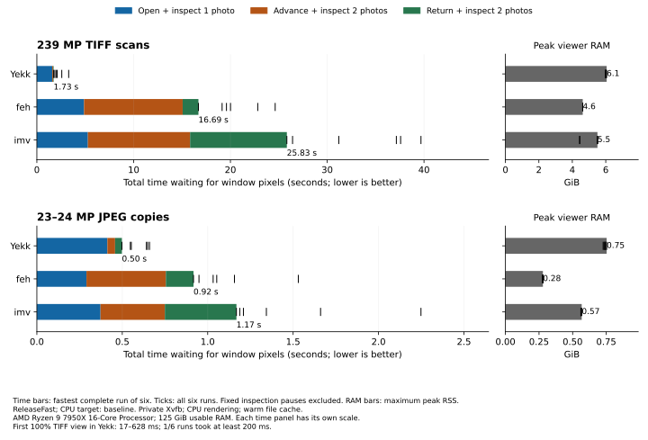
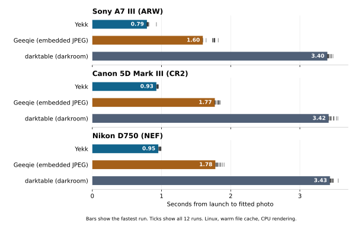

# Yekk

I paid for the whole machine and I'm going to use the whole machine.

Yekk is an image viewer for macOS and Linux, written in Zig. It aggressively caches decoded image data to make interactive use as snappy as possible. It will use all of your RAM if it can, and politely return it when the OS requests.

Runs on macOS 14+ or Linux with X11 or Wayland.
Both platforms support JPEG XL and camera RAW, including
Sony ARW, Canon CR2 and CR3, Nikon NEF, Fujifilm RAF and DNG.
RAW support depends on the camera model.

Download macOS and Linux binaries from [Releases](https://github.com/asingleoat/yekk/releases).

## Performance

Review three photos at fit-to-window and 100%, then revisit the first two.
With 239 megapixel TIFFs, minimum total waiting time was 2.04 s for Yekk,
20.13 s for feh and 32.38 s for imv.

Yekk used more RAM. Its first 100% TIFF view took up to 0.58 s.
feh opened the first JPEG faster than Yekk.



This ReleaseFast Linux CPU test read all image files before each run to warm the
OS file cache.
See the [method, all timings and limits](docs/viewer-comparison.md).

### Camera RAW

On Linux, the fastest times from launch to the first fitted photo across three
RAW files were 0.79–0.95 s for Yekk, 1.60–1.78 s for Geeqie, and 3.40–3.43 s
for darktable. Geeqie showed the camera's embedded JPEG. Yekk and darktable
developed the sensor data.



See the [RAW test method and all timings](docs/raw-comparison.md).

## Build and run

[Nix](https://nixos.org/) supplies Zig master and dependencies at the versions recorded in `flake.lock`.

```sh
nix develop path:.
zig build -Doptimize=ReleaseFast
./zig-out/bin/yekk /path/to/photos
```

With no arguments, Yekk opens the current directory. A file argument opens only
that image. Use `--browse FILE` to include other images from the same directory.
Use `-r` to include subdirectories. Use `--help` to list options.
Use `--aggressive` to preload the rest of the image list while RAM is available.

## Controls

| Control | Action |
| --- | --- |
| Left / Right | Previous / next image |
| Up / Down | Zoom in / out |
| * | Actual size |
| / | Fit to window |
| Left drag | Pan |
| ? | Show key bindings |
| q | Quit |

See the [feh compatibility reference](docs/feh-compatibility.md) for options,
controls, configuration and hook examples.

## Documentation

- [Linux support](docs/linux.md)
- [Architecture](docs/architecture.md)
- [Performance techniques](docs/performance.md)
- [Testing and benchmarks](docs/validation.md)
- [Release packaging](docs/release.md)

Licensed under [GPL-3.0-or-later](LICENSE).
